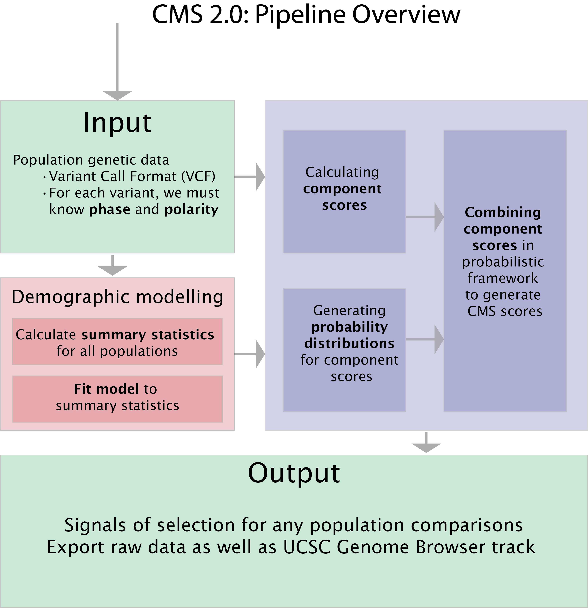

Description of the method
==========================

*Composite of Multiple Signals (CMS)* refers to a family of tests applied to population genetic datasets in order to (i) identify genomic regions that may have been subject to strong recent positive selection (a 'sweep') and (ii) to narrow signals of selection within such regions, in order to identify tractable lists of candidate variants for experimental scrutiny. In both of these cases, CMS requires (a) phased variation data for several populations, along with (b) ancestral allele status ('allele polarity') for a majority of sites listed. It was developed with humans in mind (e.g., the 1000 Genomes Project) but could in principle be applied to any diploid species with data in VCF or TPED format. 

In its current instantiation (**'CMS 2.0'**), it includes scripts to (i) calculate a variety of selection metrics for each population, (ii) model the demographic history of the dataset using an exploratory approach, (iii) generate probability distributions for each selection metric from data simulated from demographic models, (iv) generate composite scores and (v) visualize signals of selection in the UCSC Genome Browser.

The method used in CMS is described in greater detail in the following paper:

`A Composite of Multiple Signals Distinguishes Causal Variants in Regions of Positive Selection <https://doi.org/10.1126/science.1183863>`_ 
Sharon R. Grossman, Ilya Shylakhter, Elinor K. Karlsson, Elizabeth H. Byrne, Shannon Morales, Gabriel Frieden, Elizabeth Hostetter, Elaine Angelino, Manuel Garber, Or Zuk, Eric S. Lander, Stephen F. Schaffner, and Pardis C. Sabeti
*Science* 12 February 2010: **327** (5967), 883-886.Published online 7 January 2010 [DOI:10.1126/science.1183863]

.. sectionauthor:: Joseph Vitti <vitti@broadinstitute.org>